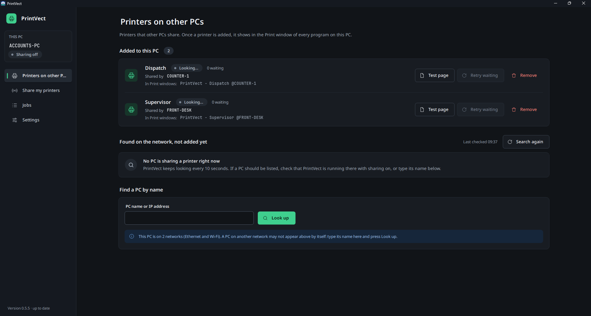
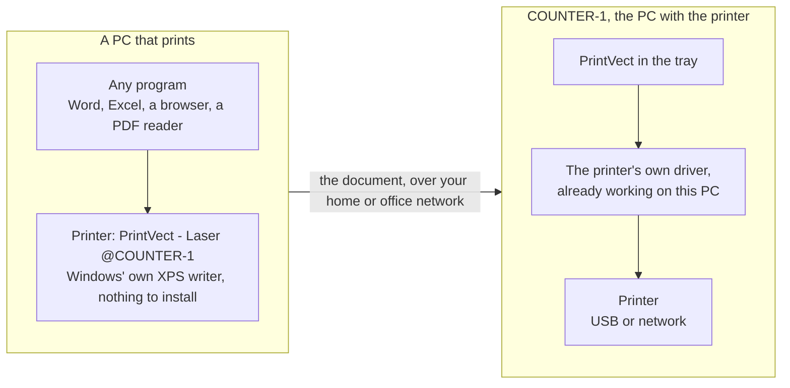
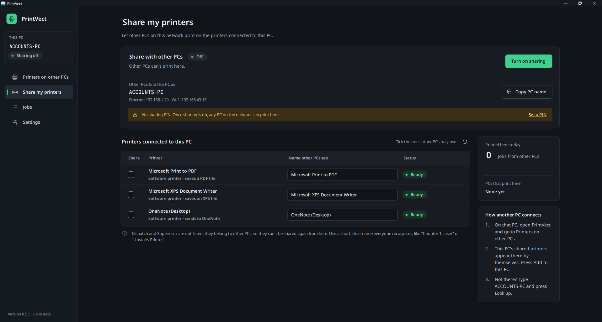
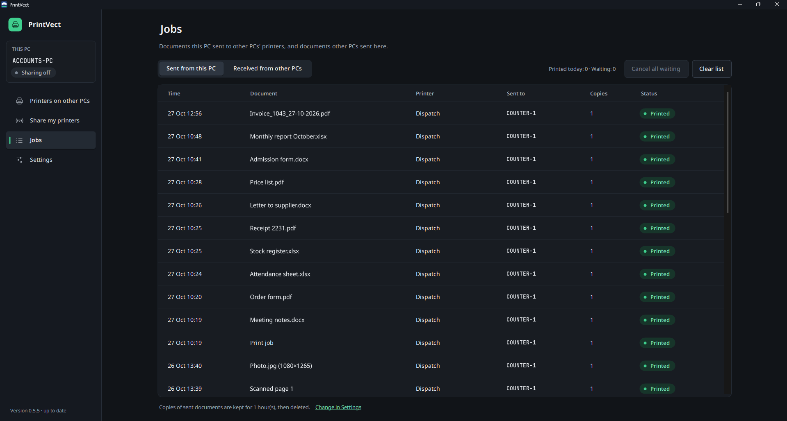
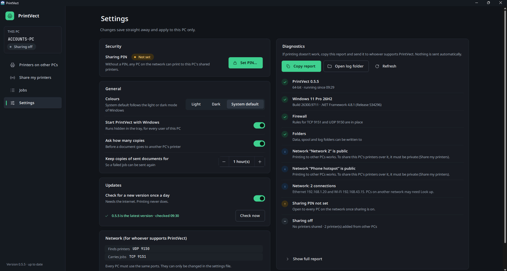

<p align="center"></p>

<h1 align="center">PrintVect</h1>

<p align="center"><b>Share a printer with every Windows PC and laptop on your network, at home or in the office.<br>
No printer drivers and no Windows passwords on the PCs that print.</b></p>

<p align="center">
<a href="https://github.com/rahulranjan-dev-py/PrintVect/releases/latest"></a>
<a href="https://github.com/rahulranjan-dev-py/PrintVect/actions/workflows/build.yml"></a>

<a href="LICENSE"></a>
</p>

<p align="center">
<a href="https://github.com/rahulranjan-dev-py/PrintVect/releases/latest"><b>Download for Windows</b></a> ·
<a href="#how-it-works">How it works</a> ·
<a href="#security-and-privacy">Security and privacy</a> ·
<a href="#troubleshooting">Troubleshooting</a>
</p>

PrintVect is a small, free tray app for homes and small offices: one printer and a few laptops at home, or several
printers and many PCs at work. The PC that has a printer shares it in a few clicks; every other PC or laptop adds it
with one click and prints to it from any program, like a printer of its own. No print server, no cloud, no accounts:
printing stays on your own network.



## Why

Windows' own printer sharing is hard work at home or in a small office without an IT department:

- Since the PrintNightmare security fixes of 2021, Windows asks for an administrator password when a PC connects to
  a shared printer and has to install its driver.
- Every PC needs the printer's driver for its own version of Windows, and some older printers have none for newer
  Windows.
- Connecting asks for a Windows user name and password of the PC that has the printer.

PrintVect side-steps all of that. The PCs that print use the Microsoft XPS Document Writer driver that Windows
already has, and the PC with the printer prints with the driver that already works there.

## How it works



1. On the PC that has the printer (the **host**), open PrintVect, **Share my printers**, **Turn on sharing**, and
   tick the printers to share.
2. On every other PC (a **client**), open PrintVect, **Printers on other PCs**: the shared printers appear by themselves.
   Press **Add to this PC**.
3. Print from any program to `PrintVect - <printer> @<PC>`. The job travels to the host and comes out of its
   printer; the **Jobs** page on both PCs shows what happened to it.

## Features

- **Finds the shared printers by itself**, over Wi-Fi or cable, on every network card of the PC; a PC name or IP
  address can be typed in too.
- **A normal Windows printer** on each client, so every program can print to it.
- **Jobs page** on both sides: sent, printed, waiting or failed, with **Retry** and **Cancel**. A job whose host is
  switched off waits and goes out with **Retry**; a job is never printed twice.
- **Asks how many copies** before a job leaves the PC (can be switched off).
- **Sharing PIN** (optional): only PCs with the same PIN can print to the shared printers.
- **Pause / Resume** a shared printer; see which PCs print on this one.
- **Phone hotspot friendly**: warns when Windows treats the network as public and fixes it with one click; a job
  finds the host's new address by itself.
- **Updates itself** from this repository's releases with one click (the daily check can be switched off).
- **Light, Dark** or the Windows setting; plain-language messages written for people who are not IT staff.
- **Diagnostics** page with a checklist and a report to copy when something does not work.
- Free and open source under the MIT licence. Built with C# and .NET Framework 4.8 (WinForms).

## Screenshots

**Share my printers**: tick the printers other PCs may use; the yellow note appears while there is no sharing PIN.



**Jobs**: every document sent from this PC or received from other PCs, with its status; right-click a job for Retry,
Cancel or Copy details.



**Settings**: the sharing PIN, Light / Dark / System default colours, updates, and Diagnostics with a checklist and a
report to copy.



## Security and privacy

- Finding printers (UDP 9150) and print jobs (TCP 9151) stay on your local network. The setup program opens those
  ports in Windows Firewall for PrintVect only, on private and domain networks only, never on public ones.
- Without a sharing PIN, any PC on the same network can print to the shared printers; set the same PIN on every
  PC to limit that (Settings, Security). Print jobs are not encrypted on the network.
- PrintVect runs as a normal user. Only its small helper, `PrintVect.Elevate.exe`, asks for administrator rights,
  for the few tasks that need them: adding or removing a printer, starting with Windows, making a network private.
- The only internet connection is the update check: once a day PrintVect asks GitHub for this repository's latest
  release, and downloads it when someone presses **Update now**. No telemetry, no crash reports, no accounts; logs and settings stay on the PC. Details:
  [CODE_SIGNING.md](CODE_SIGNING.md), which also holds the privacy policy.
- To report a security problem, see [SECURITY.md](SECURITY.md).

## Download

Download the latest **PrintVect-Setup-<version>.exe** from this repository's
[Releases](https://github.com/rahulranjan-dev-py/PrintVect/releases/latest) and run it on each PC or laptop (it asks
for administrator rights once). PCs that already run PrintVect find new versions by themselves (Settings, Updates).
What changed in each version: [CHANGELOG.md](CHANGELOG.md).

Requirements:

- Windows 10 or 11, 32-bit or 64-bit (tested). Windows 7 SP1, 8 and 8.1 should work but are not tested.
- .NET Framework 4.8. Windows 10 (May 2019 update or later) and Windows 11 already have it. Windows 7 and 8.1 need
  the offline installer `ndp48-x86-x64-allos-enu.exe`; Windows 7 also needs SP1 plus updates KB4474419 and
  KB4490628 first.
- All PCs on the same network (the same Wi-Fi or router).

**Not signed yet** (see [CODE_SIGNING.md](CODE_SIGNING.md)). Until the first signed release:

- Windows SmartScreen may warn when the setup program first runs: click **More info**, then **Run anyway**.
- Chrome or Edge may hold the download back; choose **Keep** in the downloads list (Ctrl+J).
- On a Windows 11 PC with Smart App Control On (Windows Security, App & browser control) Windows refuses to run the
  unsigned setup program ("An Application Control policy has blocked this file"), including through Update now.
- The `.sha256` file next to each setup program is its checksum; PrintVect checks it before installing an update.

## Using it

The window has a menu on the left: the PC's name and whether it shares its
printers at the top, then four pages, and the version at the bottom. Settings, **Colours** picks **Light**,
**Dark** or **System default** (the light or dark mode of Windows, followed when it changes).

- **Printers on other PCs**: the printers of other PCs already on this PC, each with its status, how many jobs
  wait for it, **Test page**, **Retry waiting** and **Remove**; the printers found on the network that are not added
  yet (they appear by themselves; **Add to this PC**, Windows asks once for permission); and **Find a PC by
  name** for a PC that does not appear (type its name or IP address, **Look up**).
- **Share my printers**: **Turn on sharing** opens a window to tick the printers to share and set the sharing
  PIN; **Turn off sharing** stops it. Below: the name other PCs find this PC by (**Copy PC name**), a yellow
  note when there is no sharing PIN (**Set a PIN**) or when Windows treats the network as public (**Make it
  private**, see Troubleshooting), and the printers of this PC with a tick, the name other PCs see (for
  example "Counter 1 Laser"), the status and **Pause** / **Resume** (jobs from other PCs wait while a printer
  is paused). Printers of other PCs added here are not listed: they cannot be shared again. On the right: the
  jobs printed today, the **PCs that print here** with their Windows and PrintVect version, and how another PC
  connects.
- **Jobs**: **Sent from this PC** or **Received from other PCs**, newest first, with today's printed and waiting
  counts, the copies, a coloured status and the job's message under the document. Right-click a job for
  **Retry** or **Cancel job** (a waiting job), **Remove from list** (a finished one) or **Copy details**; Delete
  does the same as Cancel or Remove. **Cancel all waiting** cancels every job this PC still has to send, **Clear
  list** removes the finished jobs from the list shown (nothing on any printer changes). A job received here that
  has not reached the printer yet (for example while the printer is paused) can be cancelled on this PC too.
- **Settings**: Security (the sharing PIN: the same PIN on every PC), General (Colours, start with Windows,
  whether printing asks how many copies, how long to keep sent documents), Updates (a daily look for a newer
  version, **Check now**, **Update now** when one is ready), the network ports, and **Diagnostics**: a checklist
  of what PrintVect checked on this PC (Windows, firewall rules, folders, networks and whether one is public,
  PIN, sharing) and **Copy report** to paste into an email or chat when something does not work. The report
  contains the Windows version, .NET version, network addresses, firewall rule state, printer list and the last
  200 log lines. Nothing is sent automatically.

Ctrl+Tab moves to the next page.

When a program prints to a PrintVect printer, a small window asks **how many copies** before the job leaves the
PC (Windows' XPS writer loses the copies chosen in the program). Enter prints, Esc cancels; after a minute without
an answer it prints the number shown. Settings can turn the question off.

Closing the window only hides it; PrintVect keeps running in the tray. To stop it, right-click
the tray icon and choose **Exit**. `PrintVect.App.exe /tray` starts it hidden (the installer's
autostart entry uses this).

### Installing with the setup program

Download `PrintVect-Setup-<version>.exe` from the latest entry on the **Releases** page of this
repository (or the `PrintVect-Setup-<n>` artifact of the latest green build on the Actions page, which is
a zip around the same file) and run it. The program is not signed yet, so SmartScreen warns once:
**More info**, then **Run anyway**. Setup installs to `C:\Program Files\PrintVect`, keeps any settings
already in `C:\ProgramData\PrintVect`, opens TCP 9151 and UDP 9150 in Windows Firewall for PrintVect
only, adds a Start menu entry and starts PrintVect with Windows (hidden in the tray). Uninstalling from
Settings, Apps removes the PrintVect printers, the firewall rules, the program and its data folder.

### Using a shared printer from another PC

On the PC that should print: open PrintVect, **Printers on other PCs**, press **Add to this PC** next to the
printer under "Found on the network" (or type the host PC's name or IP address under **Find a PC by name**,
**Look up**, then **Add to this PC**) and answer **Yes** to the Windows permission window. A printer named `PrintVect - <printer> @<host PC>` appears in every program's
print window; what you print on it comes out of the host's printer. `PrintVect.Elevate.exe` is the
only part that runs as administrator: it creates the printer, its port and its spool folder
(`C:\ProgramData\PrintVect\spool\<id>`), and removes them again (**Remove**, or
`PrintVect.Elevate.exe remove-all` from an administrator Command Prompt to remove every PrintVect
printer at once).

### Sending a test job with pvct-send (no virtual printer needed)

`pvct-send.exe` sits next to `PrintVect.App.exe`. From a Command Prompt on any PC that has
.NET Framework 4.8:

```
pvct-send list 192.168.1.5
pvct-send PrintVect-test-page.xps 192.168.1.5 "Counter 1 Laser"
pvct-send status 192.168.1.5 <job id>
```

`192.168.1.5` is the host PC's address (shown on its Share my printers page, and under Network in Settings, Diagnostics); a PC
name works too. `PrintVect-test-page.xps` is a ready-made one-page test file. Any other
`.xps` file works: print a document to "Microsoft XPS Document Writer" to make one. Options:
`/pin 1234` when the host has a PIN, `/doc "title"`, `/port 9151`, `/nowait`.

If another PC cannot reach the host, the Windows Firewall on the host is blocking port 9151 (on a phone
hotspot: see Troubleshooting). Without the installer, run this once on the host as administrator:

```
netsh advfirewall firewall add rule name="PrintVect Jobs (TCP-In)" dir=in action=allow protocol=TCP localport=9151 program="C:\PrintVect\PrintVect.App.exe" profile=private,domain
netsh advfirewall firewall add rule name="PrintVect Discovery (UDP-In)" dir=in action=allow protocol=UDP localport=9150 program="C:\PrintVect\PrintVect.App.exe" profile=private,domain
```

## Where things are

| Item | Location |
|------|----------|
| Settings | `C:\ProgramData\PrintVect\config.json` |
| Job files in transit | `C:\ProgramData\PrintVect\spool\` (received files: `spool\incoming\`, deleted once printed) |
| Logs (one per day, kept 14 days) | `C:\ProgramData\PrintVect\logs\PrintVect-<date>.log` |
| Admin helper log | `C:\ProgramData\PrintVect\logs\PrintVect-Elevate-<date>.log` |
| pvct-send log | `C:\ProgramData\PrintVect\logs\PrintVect-Send-<date>.log` |
| Downloaded update and its setup log | `C:\ProgramData\PrintVect\updates\PrintVect-Setup-<version>.exe`, `update-<version>.log` |
| Ports | UDP 9150 (finding printers), TCP 9151 (sending jobs) |
| Update check | HTTPS to `api.github.com` and `github.com` only (this repository's releases) |

`ProgramData` is a hidden folder; type the path into the Explorer address bar.

## Troubleshooting

| Problem | What to do |
|---------|------------|
| "PrintVect could not create its data folder" at start | Ask whoever installed PrintVect to check that `C:\ProgramData\PrintVect` can be written to. |
| No tray icon after starting | Check the hidden icons arrow next to the clock. If still nothing, look for the newest file in `C:\ProgramData\PrintVect\logs\`. |
| Chrome or Edge blocks the download as dangerous | Unsigned new program; use **Download dangerous file** / **Keep** from the download's menu (see above). |
| Antivirus on Windows 7 quarantines the EXE | Add the PrintVect folder and `C:\ProgramData\PrintVect` to its exclusions; the program is unsigned for now. |
| "is reachable but nothing is listening" from pvct-send | On the host, open PrintVect and switch sharing ON. |
| "Neither Microsoft XPS Document Writer nor ... v4 is installed" when adding a printer | PrintVect installs Windows' own XPS Document Writer itself. If it still fails: Settings, Apps, Optional features, More Windows features, tick **Microsoft XPS Document Writer**, OK, restart if asked, then Add again. |
| "is not reachable on the network" from another PC | Check the host's IP address on its Share my printers page, then add the firewall rule above on the host. |
| Printing stops when the PCs use a phone hotspot | Windows treats a hotspot as a **public** network, and PrintVect's firewall rules let other PCs in on private networks only. On the PC that shares the printer, Share my printers shows a yellow note: press **Make it private** and answer **Yes** (or in Windows: Settings, Network, the Wi-Fi, Network profile type **Private**). A PC that prints finds the host's new hotspot address by itself; waiting jobs: **Retry waiting** on Printers on other PCs. |
| The host says the job is still printing after 60 s | Look at the printer and at the Windows print queue on the host (Settings, Printers & scanners, the printer, Open print queue). The job is in that queue and prints when the printer is ready; PrintVect keeps reporting its page progress for up to 15 minutes. |
| Microsoft Print to PDF: the job shows Printing until you answer the Save window | That is how Windows works: choose a file name and the job becomes Printed. |
| Settings says "Could not check for a newer version: this PC cannot reach github.com" | The PC has no internet connection right now (or a proxy blocks github.com). Printing is not affected; the check tries again the next day, or press **Check now** later. |
| "The update did not run (the setup program ended with code ...)" | The Windows permission question was answered No, or the setup failed: the reason is in `C:\ProgramData\PrintVect\updates\update-<version>.log`. Press **Update now** again. |
| After an update PrintVect did not come back | Start it from the Start menu; the update itself is complete. Tell the person who supports PrintVect which version the window shows. |
| A job waits with "asks for the sharing PIN" | The two PCs have different sharing PINs (or one has none). Set the same PIN in Settings on both, then press **Retry waiting** (Printers on other PCs) on the PC that printed. |
| A job waits with "is paused there" | Someone pressed **Pause** on the PC that has the printer. Press **Resume** there (Share my printers). |
| A job waits with "stopped answering after it received this job" | The PC with the printer was switched off or lost the network during the job. When it is back, check whether the page came out; if not, press **Retry waiting** (or right-click the job, **Retry**). A page that already printed is never printed twice. |
| Update now says jobs are still being handled | A shared printer is paused with jobs waiting. Resume it (or wait until they printed), then press Update now again. |
| Something else | Settings, Diagnostics, **Copy report**, and send the text to the person who supports PrintVect. |

## Building from source

Install Visual Studio 2022 Build Tools with the ".NET Framework 4.8 targeting pack", then run in the repo folder:

```
msbuild PrintVect.sln /t:Restore /p:Configuration=Release
msbuild PrintVect.sln /p:Configuration=Release
tests\PrintVect.Tests\bin\Release\net48\PrintVect.Tests.exe
```

`dotnet build PrintVect.sln -c Release` with the .NET 8 SDK works too.

## Help and feedback

- Questions, problems and ideas: open an [issue](https://github.com/rahulranjan-dev-py/PrintVect/issues/new/choose).
  For a problem, add the report from Settings, Diagnostics, **Copy report** (read it first: it holds the PC's name,
  its network addresses and the printer names).
- Contributions are welcome: see [CONTRIBUTING.md](CONTRIBUTING.md).
- If PrintVect saves you some trouble, please give it a star on GitHub: it helps other homes and offices find it.

## For developers

- `CLAUDE.md` holds the condensed rules; the full brief is `docs/brief.md`.
- `docs/protocol.md` describes the wire protocol; `docs/testing.md` the manual test steps per version;
  `docs/releasing.md` how a new version is published.
- Every user-visible string lives in `src/PrintVect.App/Strings.resx`. After editing it without
  Visual Studio, run `python3 tools/generate_strings.py`.

## Licence

MIT, see [LICENSE](LICENSE). Fonts: SIL Open Font License 1.1 (`src/PrintVect.App/Fonts`).
